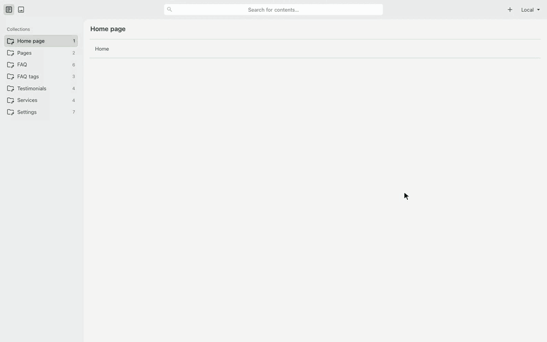

# stomme

A block-based site engine for Astro, for developers who build sites that other people edit: pages are stacks of typed blocks, editors change them in a Git-backed CMS with a live preview of the real components, and the site ships static.



[Watch it as video](docs/assets/admin.mp4)

## Install

You need Node.js 22.19 or later, pnpm 11 and git.

```bash
pnpm create stomme my-site
cd my-site && pnpm install && pnpm dev
```

The scaffolder asks whether to start from a blank site or the Wren & Sorrel demo, a finished site for a fictional garden studio to explore. `--blank` or `--demo` after the directory skips the question, and without a terminal it makes the blank site. The site installs the engine from the npm registry. With `npm i -g @gronare/stomme`, `stomme new my-site` does the same.

The site runs at `http://localhost:4321` and every block with sample content at `/lookbook`. The CMS at `/admin` edits the files on disk in Chrome or Edge. Name your GitHub repository in `site.cms` to edit through GitHub instead. [Your first site](docs/tutorial.md) takes it from here to a page edited in the CMS and built.

To work on the engine itself, clone the repository, run `pnpm install` in it and scaffold with `node stomme/packages/create-stomme/bin/create.mjs my-site`, which links the site to the clone.

Inside a site, `pnpm stomme` lists the commands: `dev`, `build --target static`, `cms`, `block new` and `lint`. See [Commands](docs/reference/commands.md).


## Usage

A page is a Markdown file whose frontmatter lists blocks in order. `type` picks the component, the rest of the block is its fields.

```yaml
# src/content/pages/pricing.md
title: Pricing
published: true
seo: { title: Pricing, description: What it costs. }
blocks:
  - type: pageHeader
    heading: Pricing
  - type: plans
    plans:
      - { name: Basic, price: $10, period: /mo }
      - { name: Pro, price: $25, period: /mo, highlight: true }
```

`pnpm build` turns it into `/pricing/`, and the CMS edits the same file.

## What you get

- **42 blocks, styled and themeable.** Heroes, cards, pricing, galleries, FAQs, forms, maps, timelines and more. Recolour with tokens in `theme.md`, no CSS framework.
- **A CMS generated from your block catalog.** `pnpm stomme cms` writes the Sveltia CMS config, and the preview renders the real components, not a copy.
- **Static by default.** Pages prerender. On an adapter build, only the live preview and the contact form's handler run on demand.
- **Deploys anywhere.** One build script each for Netlify, Cloudflare Workers, Vercel, a Node server or plain static hosting.
- **Optional features behind flags.** A blog with a calendar feed, services, service areas, testimonials, documents, listings (news, a for-sale catalog) and a docs section built from a repo.
- **Your own blocks beside the library.** Add a component, register it, list its fields, and it shows in the CMS and the preview.
- **Built-in SEO.** Canonical URLs, Open Graph tags, generated share cards, a sitemap, `robots.txt`, hreflang for translated pages and local-business JSON-LD.
- **First-party metrics with no cookies.** One inline script beacons pageviews, contact intents, block views and Web Vitals to an endpoint you run.

## Documentation

[The documentation](docs/README.md) is a tutorial, how-to guides, reference and explanation. Good places to start:

- [Your first site](docs/tutorial.md): scaffold, edit a page in `/admin`, build
- [Blocks](docs/reference/blocks.md) and [Site config](docs/reference/site-config.md)
- [Deploy a site](docs/how-to/deploy.md)
- [How stomme fits together](docs/explanation/how-it-fits-together.md)

## License

[AGPL-3.0-only](LICENSE). Use, modify and self-host stomme freely, client work included. If you distribute it, or run a modified version as a network service, pass the same freedoms on.
